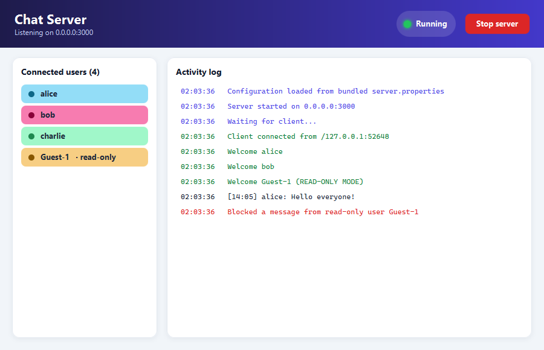
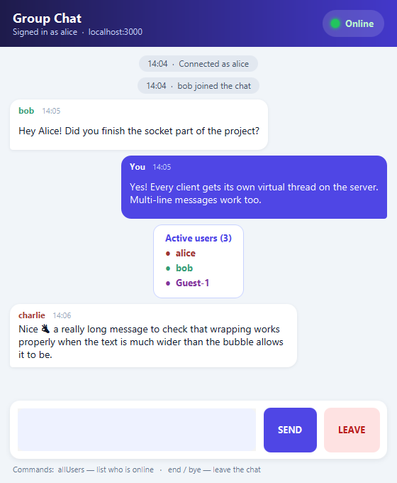
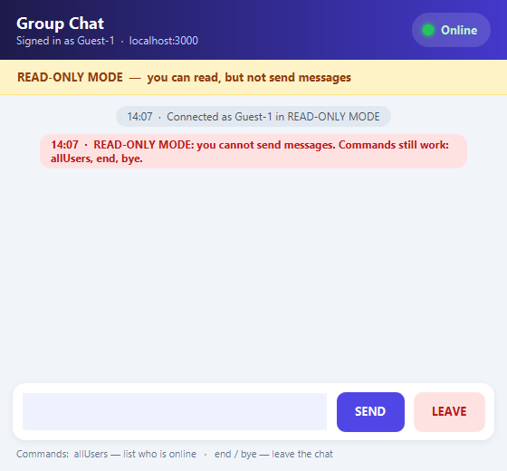
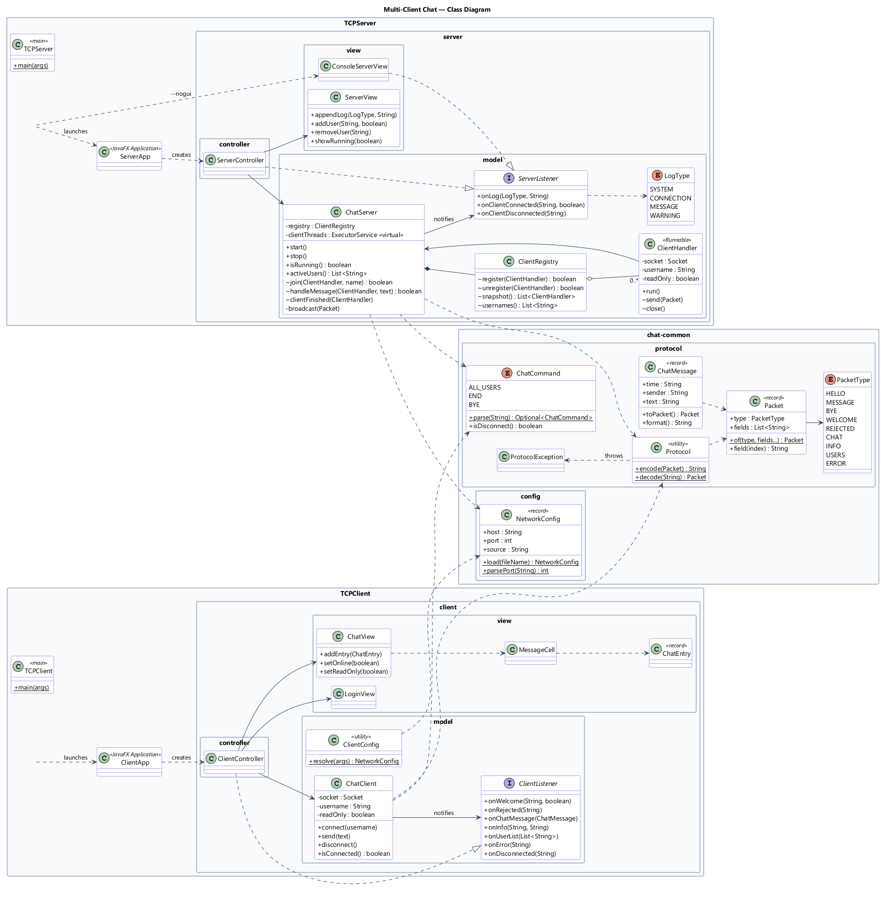
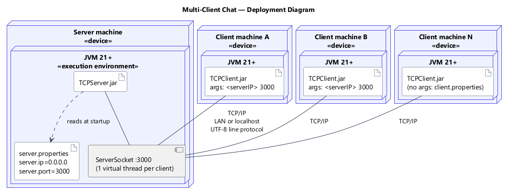
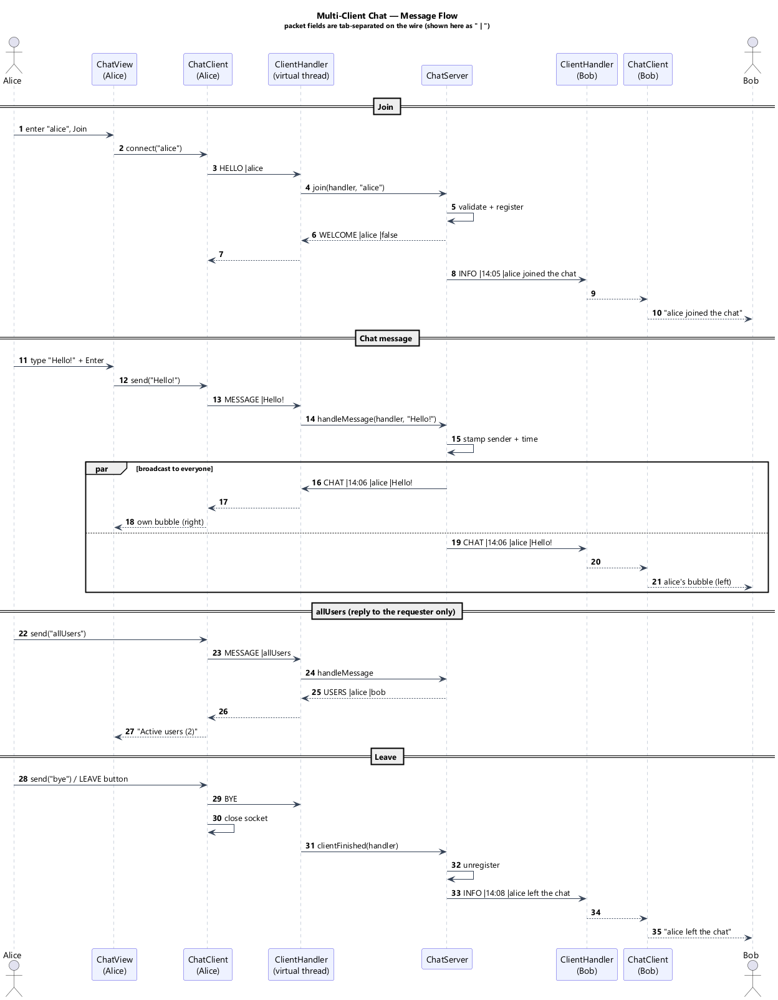
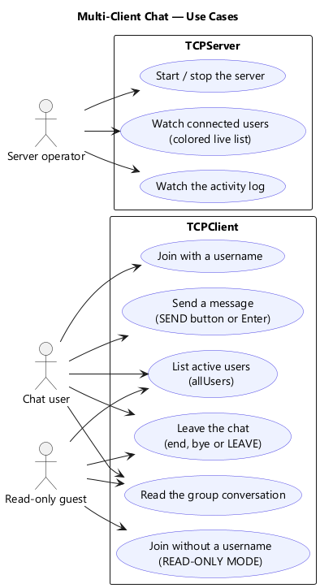

# Multi-Client Chat Application — Java Sockets, Virtual Threads & JavaFX

A real-time **group chat** built from scratch on raw **TCP sockets**. One central **TCPServer** accepts any number of **TCPClient** applications. Each client gets its own **virtual thread** on the server, and every message is stamped with the sender's name and the time before it is relayed to the whole group.

Both applications have a **JavaFX** interface (laid out with `GridPane`, styled with CSS). The code follows a strict **Model–View–Controller** split. The networking models never import JavaFX, so the same server can also run in a terminal (`--nogui`), and the test suite drives both models over real sockets without opening a window.

> Mini Project 1 — Programming Paradigms

| Server | Client | Read-only mode |
|:---:|:---:|:---:|
|  |  |  |

---

## Table of contents

1. [Features](#features)
2. [Quick start](#quick-start)
3. [Configuration](#configuration)
4. [Architecture](#architecture)
5. [The wire protocol](#the-wire-protocol)
6. [Project structure](#project-structure)
7. [Testing](#testing)
8. [Design decisions](#design-decisions)
9. [Requirements checklist](#requirements-checklist)
10. [Deliverables](#deliverables)

---

## Features

### Client (`TCPClient`)
- **Username login.** Users choose a name before entering the chat. Names are unique (ignoring case) and validated by the server.
- **READ-ONLY MODE.** Joining with an empty username makes you a guest (`Guest-1`, `Guest-2`, …). Guests can read the conversation but not send messages. This rule is enforced twice: the client blocks the message locally, and the server refuses it anyway.
- **Real-time messaging.** Type in the text area and press **SEND** or **Enter** (**Shift + Enter** inserts a new line; multi-line messages are supported).
- **`allUsers` command.** Asks the server for the list of active users. The reply goes **only to the user who asked**.
- **Disconnection** with `end`, `bye` or the **LEAVE** button. The client sends a `BYE` packet, so the server is notified, then closes the socket.
- **Status indicator.** An **Online / Offline** label next to a colored **circle** (green = online, red = offline).
- Chat-bubble layout: your own messages on the right, others on the left with a per-user color, plus system notices for joins and leaves.

### Server (`TCPServer`)
- **Concurrent connections.** One **virtual thread per client** (`Executors.newThreadPerTaskExecutor(Thread.ofVirtual()…)`). The test suite runs 200 simultaneous clients.
- **Message distribution.** Every message is formatted with the **sender's username and the time** and broadcast to all active connections.
- **Live user list.** A `ListView` of connected usernames, each with a **random background color**; read-only guests are marked.
- **Activity log.** `Server started…`, `Waiting for client...`, `Welcome <user>`, messages, departures and warnings, color-coded by type.
- **Start / Stop** button. When stopping, the server says goodbye to every client before closing their connections.
- **Headless mode.** `--nogui` runs the same server model with console output instead of a window.

---

## Quick start

### Prerequisites
- **JDK 21 or newer** (virtual threads are final since Java 21). Tested with JDK 22.
- Nothing else. The Maven Wrapper (`mvnw`) downloads Maven, and Maven downloads JavaFX.

### Ready-made JARs
Pre-built executable JARs are in [`dist/`](dist): **`dist/TCPServer.jar`** and **`dist/TCPClient.jar`**. With JDK 21+ installed, you can run them directly:

```bash
java -jar dist/TCPServer.jar
java -jar dist/TCPClient.jar localhost 3000
```

### Build both executable JARs yourself

```bash
# Windows
mvnw.cmd clean package

# macOS / Linux
./mvnw clean package
```

This compiles the three modules, runs the 48 tests, and produces two self-contained JARs (JavaFX is bundled inside):

```
TCPServer/target/TCPServer.jar
TCPClient/target/TCPClient.jar
```

### Run

```bash
# 1. Start the server (reads server.properties: 0.0.0.0:3000 by default)
java -jar TCPServer/target/TCPServer.jar

# 2. Start as many clients as you like, in other terminals
java -jar TCPClient/target/TCPClient.jar localhost 3000
java -jar TCPClient/target/TCPClient.jar localhost 3000

# Optional: the same server without a window
java -jar TCPServer/target/TCPServer.jar --nogui
```

The command lines from the assignment, `java TCPServer` and `java TCPClient <ServerIPAddress> <PortNumber>`, map to the launcher classes `com.chatapp.server.TCPServer` and `com.chatapp.client.TCPClient`.

**Chatting across machines on a LAN:** run the server on one computer, find its IP address (`ipconfig` on Windows, `ip a` on Linux), and start clients on other computers with `java -jar TCPClient.jar 192.168.x.y 3000`. Allow Java through the firewall when Windows asks.

> On startup JavaFX prints `WARNING: Unsupported JavaFX configuration: classes were loaded from 'unnamed module'`. This is expected for a single "fat" JAR and has no effect.

### Run from IntelliJ IDEA
Open the project folder. IntelliJ imports it as a Maven project, and the shared run configurations appear in the toolbar:

| Run configuration | What it starts |
|---|---|
| `TCPServer` | Server window |
| `TCPServer (console, --nogui)` | Same server, console output |
| `TCPClient 1` / `2` / `3` | Client windows connecting to `localhost 3000` |
| **`Demo (server + 3 clients)`** | All of the above at once: one click for a live demo |

---

## Configuration

The server IP and port are **loaded at runtime from a `.properties` file**, so you can change the deployment without recompiling.

`server.properties` (bundled default):
```properties
server.ip=0.0.0.0     # all network interfaces; use 127.0.0.1 for local-only
server.port=3000
```

`client.properties` (used only when the client is started **without** arguments):
```properties
server.ip=localhost
server.port=3000
```

**Lookup order:** later sources override earlier ones.

| Priority | Source |
|---|---|
| 1 (lowest) | File bundled inside the JAR |
| 2 | A file with the same name in the **working directory** (next to the JAR) |
| 2 | Or an explicit path: `java -Dchat.config=/path/to/server.properties -jar TCPServer.jar` |
| 3 (client only) | **Command-line arguments**: `TCPClient <ServerIPAddress> <PortNumber>` |

Example: to move the server to port 5000, create `server.properties` with `server.port=5000` next to `TCPServer.jar` and restart. No rebuild is needed. The server log shows which file it loaded.

---

## Architecture

### Model–View–Controller

```
┌───────────── View (JavaFX) ─────────────┐   ┌─────── Controller ───────┐   ┌──────── Model (pure Java) ────────┐
│ ServerView    (GridPane + server.css)   │◄──│ ServerController         │◄──│ ChatServer, ClientHandler,        │
│ ConsoleServerView (text-only view)      │   │  implements ServerListener│   │ ClientRegistry  → ServerListener  │
│ LoginView, ChatView, MessageCell        │◄──│ ClientController         │◄──│ ChatClient      → ClientListener  │
│   (GridPane + client.css)               │──►│  implements ClientListener│──►│                                   │
└─────────────────────────────────────────┘   └──────────────────────────┘   └───────────────────────────────────┘
                                                                                 chat-common: Protocol, Packet,
                                                                                 ChatCommand, NetworkConfig
```

- The **model** (`…model` packages and `chat-common`) owns sockets, threads, the protocol and the chat rules. It reports events through a small **listener interface** (the Observer pattern) and **has no JavaFX imports**.
- The **view** only knows how to display things. It exposes methods such as `appendLog`, `addUser` and `setOnline`, plus callbacks for button clicks. It **never touches a socket**.
- The **controller** implements the listener interface and forwards each event to the view with `Platform.runLater(...)`, because model events arrive on network threads but JavaFX may only be updated from its own UI thread.

**Proof that the layers are independent:** the server model runs unchanged behind two different views (`ServerView` and `ConsoleServerView` via `--nogui`), and the test suite runs both models end to end over real TCP with no UI at all.

### Threading model

| Thread | Where | Job |
|---|---|---|
| `accept-loop` (virtual) | server | Blocks on `ServerSocket.accept()`, logs *"Waiting for client..."*, hands each socket to a new handler |
| `client-1`, `client-2`, … (virtual) | server | One `ClientHandler` per connection: handshake, then a blocking read loop |
| `server-listener` (virtual) | client | Reads packets from the server and calls the `ClientListener` |
| `connect` (virtual) | client | Opens the connection without freezing the login screen |
| JavaFX Application Thread | both | All UI updates (reached via `Platform.runLater`) |

Shared state is kept small and safe. `ClientRegistry` is a `synchronized` map and broadcasts iterate over a **snapshot**. Each handler serializes its own socket writes with a lock, so two broadcasts can never interleave bytes on the same connection.

### UML diagrams
Sources are in [`docs/uml`](docs/uml) (PlantUML); rendered images are in [`docs/images`](docs/images).

**Class diagram**


**Deployment diagram**: one server node and N client nodes linked by TCP/IP


**Sequence diagram**: join, broadcast, `allUsers`, leave


**Use-case diagram**


---

## The wire protocol

TCP gives us a reliable **byte stream**, not messages, so the application needs its own framing. Each packet is **one UTF-8 line**: a type followed by tab-separated fields.

```
TYPE<TAB>field1<TAB>field2…<LF>
```

Inside a field, `\`, tab, CR and LF are escaped as `\\`, `\t`, `\r` and `\n`, so a field can never break the framing. This is what makes multi-line messages safe.

| Direction | Packet | Fields | Meaning |
|---|---|---|---|
| C → S | `HELLO` | username (may be empty) | First packet. Empty name means READ-ONLY MODE |
| C → S | `MESSAGE` | text | Chat text **or** a command (`allUsers`, `end`, `bye`) |
| C → S | `BYE` | – | Client is leaving |
| S → C | `WELCOME` | username, readOnly | Handshake accepted |
| S → C | `REJECTED` | reason | Name taken or invalid; the server then closes the socket |
| S → C | `CHAT` | time, sender, text | A message stamped by the server |
| S → C | `INFO` | time, text | Joins, leaves, shutdown notice |
| S → C | `USERS` | user1, user2, … | Reply to `allUsers` (sent to the requester only) |
| S → C | `ERROR` | reason | Request refused (e.g. read-only user tried to send) |

---

## Project structure

```
chat-app/                         ← parent POM (multi-module Maven build)
├── chat-common/                  ← shared, UI-free code
│   └── com/chatapp/common/
│       ├── protocol/             Packet, PacketType, Protocol, ChatCommand, ChatMessage
│       └── config/               NetworkConfig (.properties loader)
├── TCPServer/
│   ├── com/chatapp/server/
│   │   ├── TCPServer.java        main: GUI or --nogui
│   │   ├── ServerApp.java        JavaFX Application: wires M, V, C
│   │   ├── model/                ChatServer, ClientHandler, ClientRegistry, ServerListener, LogType
│   │   ├── controller/           ServerController
│   │   └── view/                 ServerView (JavaFX), ConsoleServerView (text)
│   └── resources/                server.properties, css/server.css
├── TCPClient/
│   ├── com/chatapp/client/
│   │   ├── TCPClient.java        main: validates <ServerIPAddress> <PortNumber>
│   │   ├── ClientApp.java        JavaFX Application
│   │   ├── model/                ChatClient, ClientListener, ClientConfig
│   │   ├── controller/           ClientController
│   │   └── view/                 LoginView, ChatView, MessageCell, ChatEntry
│   └── resources/                client.properties, css/client.css
├── docs/
│   ├── uml/                      PlantUML sources
│   ├── images/                   rendered diagrams + screenshots
│   ├── VIDEO_SCRIPT.md           3-minute demo video script and recording guide
│   └── BLOG_POST.md              technical blog post
├── .run/                         shared IntelliJ run configurations
└── mvnw, mvnw.cmd                Maven Wrapper
```

---

## Testing

```bash
mvnw.cmd test        # or ./mvnw test
```

**48 automated tests**, all running without any GUI:

| Module | Test class | What it proves |
|---|---|---|
| chat-common | `ProtocolTest` | Encoding round-trips for tabs, newlines, backslashes, emoji and empty fields; bad input rejected |
| chat-common | `ChatCommandTest` | `allUsers` / `end` / `bye` matched case-insensitively; "bye everyone" is *not* a command |
| chat-common | `NetworkConfigTest` | Bundled defaults, external file override, port validation |
| TCPServer | `ChatServerTest` | Welcome, guest naming, broadcast with time stamp, `allUsers` reply to requester only, read-only refusal, duplicate and invalid names, `bye`, abrupt disconnects, **200 concurrent clients**, stop and restart |
| TCPClient | `ChatClientTest` | **End to end:** real `ChatClient`s against a real `ChatServer`: messaging, read-only blocking, `end`/`bye`, rejection, server shutdown, unreachable server |
| TCPClient | `ClientConfigTest` | Command-line arguments vs. `client.properties`, bad arguments |
| both apps | `ModelIndependenceTest` | Fails the build if any class in a `model` package uses JavaFX |

---

## Design decisions

- **Virtual threads instead of a thread pool.** The blocking "one thread per client" style is the easiest concurrent code to read. With platform threads it does not scale, because each one reserves about 1 MB of stack. Virtual threads keep the simple blocking style and cost only a few hundred bytes each, so thousands of idle chat connections are cheap.
- **A line-based text protocol** instead of Java serialization. It is human-readable (you can debug it with `telnet`), language-neutral and safe, because no object deserialization of untrusted data takes place.
- **The server is the authority.** Timestamps, username validation, uniqueness and the read-only rule are all decided on the server, so a modified client cannot bypass them. The client also checks read-only locally for instant feedback.
- **Commands are interpreted by the server.** `allUsers` travels as a normal `MESSAGE`, and the server recognizes it and replies only to the sender, as the specification requires.
- **Sender included in broadcasts.** Everyone, including the author, sees the same server-stamped message, so all clients show identical timestamps and ordering.
- **Fat JARs with a non-`Application` launcher.** `TCPServer`/`TCPClient` contain a plain `main` that calls `Application.launch(...)`, which lets JavaFX start from a single shaded JAR on the classpath.

---

## Requirements checklist

| Requirement | Where |
|---|---|
| Central server distributing messages to all clients | `ChatServer.broadcast` |
| Username before accessing the chat | `LoginView` → `HELLO` handshake |
| READ-ONLY MODE without a username | `ChatServer.join`, `ChatClient.send`, `ChatView.setReadOnly` |
| SEND button or Enter | `ChatView.buildInputBar` |
| `allUsers` returns the user list to that user only | `ChatServer.handleMessage` → `USERS` |
| `end`, `bye` or LEAVE disconnects and notifies the server | `ChatClient.disconnect` (`BYE`) |
| "Online" label and circle indicator | `ChatView.setOnline` |
| Multiple concurrent clients with **virtual threads** | `ChatServer.start` |
| Message formatted with username and time | `ChatMessage` created in `ChatServer.handleMessage` |
| Live `ListView` of usernames with random colors | `ServerView.UserCell` |
| Log: Server started, Waiting for client, Welcome | `ChatServer.start`, `acceptLoop`, `join` |
| Java sockets (TCP) | `ServerSocket` / `Socket` |
| JavaFX with **GridPane** and **CSS** | every view; `server.css`, `client.css` |
| IP and port from a config file at runtime | `NetworkConfig.load` + `.properties` |
| Model–View separation | `model` packages have no JavaFX imports; `--nogui`; headless tests |
| `java TCPClient <ip> <port>` / `java TCPServer` | `TCPClient.main`, `TCPServer.main` |
| Maven projects + executable JARs | `pom.xml` files, `maven-shade-plugin` |
| Class and deployment diagrams (+ sequence and use case) | `docs/uml`, `docs/images` |

---

## Deliverables

- **Source code:** https://github.com/Ghallium1/multi-client-chat (Maven multi-module project)
- **Executable JARs:** [`dist/TCPServer.jar`](dist/TCPServer.jar) and [`dist/TCPClient.jar`](dist/TCPClient.jar) (or build with `mvnw package`)
- **Demo video:** *add your link here*
- **Technical blog post:** *add your link here*
- **UML:** [`docs/uml`](docs/uml) and [`docs/images`](docs/images)
